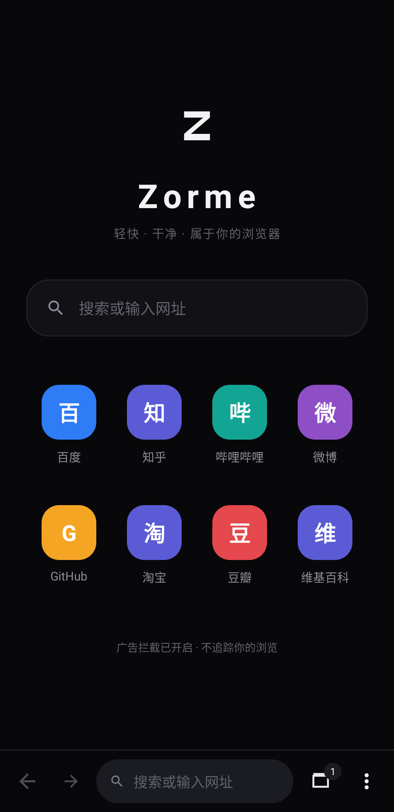
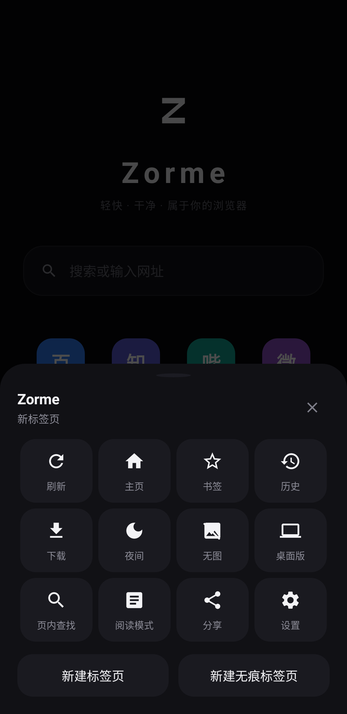
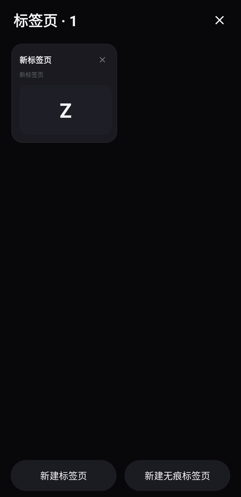
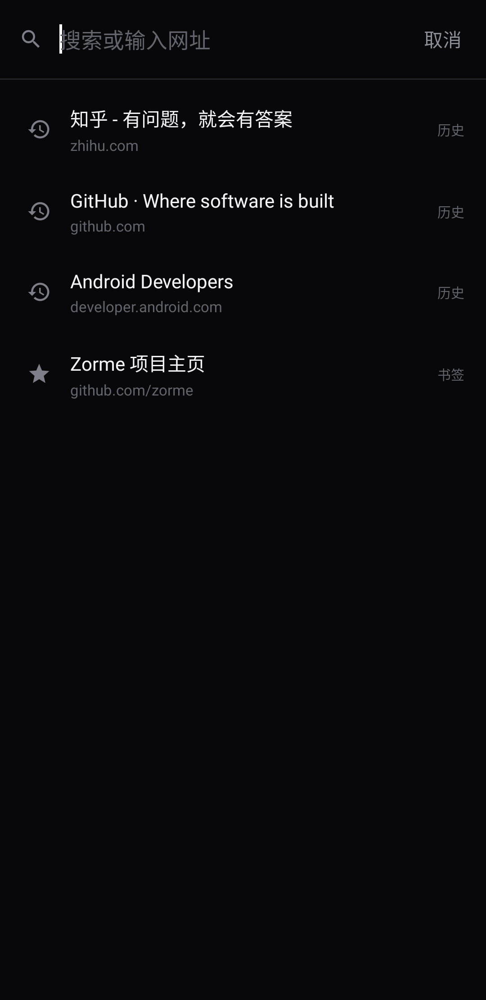
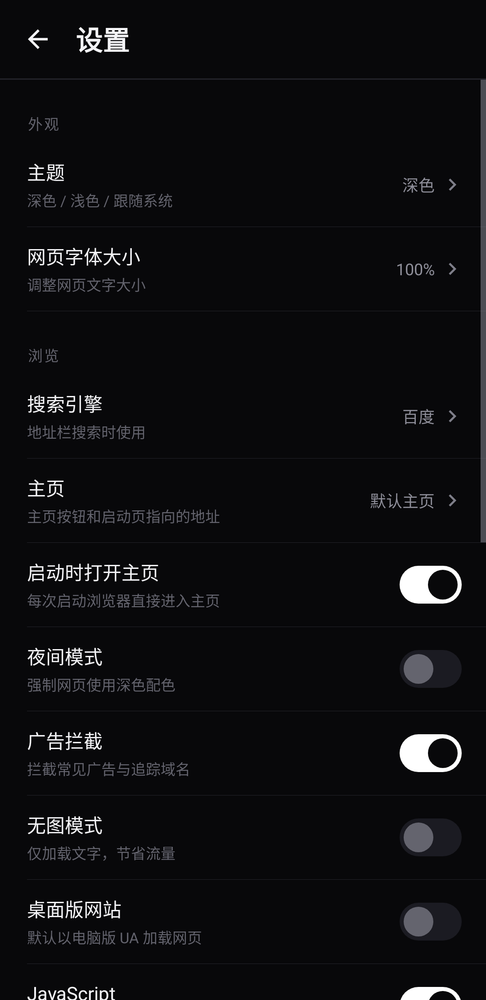
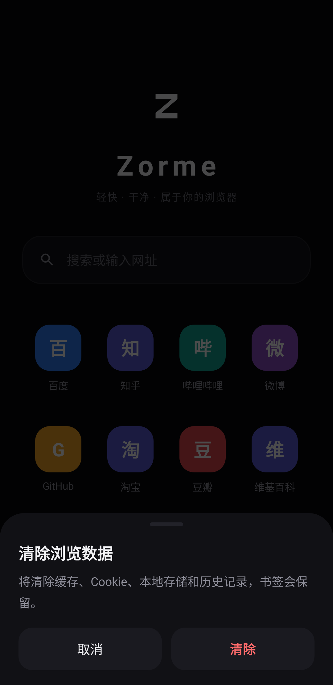

<p align="center">
  
</p>

<h1 align="center">Zorme 浏览器</h1>

<p align="center">
  基于 Android 系统 WebView 构建的轻量浏览器<br/>
  <b>轻量、干净、不打扰</b>
</p>

<p align="center">
  <a href="https://github.com/lmxdg/ZormeBrowser/releases/latest"></a>
  
  
  
</p>

---

## 下载

前往 [Releases](https://github.com/lmxdg/ZormeBrowser/releases) 页面下载最新的已签名 APK，下载后直接安装即可（安装时允许"未知来源应用"）。

也可以在应用内检查更新：**菜单 → 设置 → 关于 → 检查更新**。Zorme 会拉取 GitHub Releases 的最新版本号与本地版本对比，发现新版本时通过内置弹窗提示，可直接下载安装包或跳转发布页。

## 功能特性

**浏览核心**
- 基于 Android 系统 WebView，多标签浏览，卡片式标签页管理（带网站实时预览截图）
- Via 风格底部地址栏：返回 / 前进 / 地址胶囊 / 标签数徽标 / 菜单，单手操作
- **菜单工具栏左右滑动翻页**：每页两行工具、一行 4 个，页尾圆点指示器，17+ 个功能入口分页直达
- 智能地址栏：自动识别网址与搜索词，本地历史、书签实时建议
- 主页起始页：黑白 Zorme 徽标、搜索框、AI 助手入口、常用网站快捷方式
- 边缘滑动前进 / 后退手势
- 网页源码查看：获取当前页面完整 HTML，支持一键复制（超长源码自动分段展示）
- 网络日志抓取：记录页面加载的全部资源请求（方法 / URL / 主文档或子资源 / 广告拦截标注），仅存内存、退出即清空，可随时清空或复制链接

**油猴脚本（userscript）**
- 菜单「油猴脚本」进入管理页：安装 / 启用 / 停用 / 删除，支持搜索脚本
- 安装方式：粘贴脚本代码，或输入 `.user.js` 直链自动下载安装
- 元数据解析：`@name` / `@namespace` / `@version` / `@match` / `@include` / `@exclude` / `@run-at` / `@grant` 等
- 按 `@match`（Chrome 扩展 pattern 风格）与 `@include`（glob 或 `/正则/`）匹配页面，`@exclude` 优先排除
- `@run-at document-start` 在页面启动时注入，其余在页面加载完成后注入
- 内置 GM_* API：`GM_getValue` / `GM_setValue` / `GM_deleteValue` / `GM_listValues`（按脚本隔离并本地持久化）、`GM_addStyle`、`GM_setClipboard`、`GM_notification`、`GM_openInTab`、`GM_download`、`GM_xmlhttpRequest`（原生 http 请求，不受页面 CORS 限制）、`GM_info`、`unsafeWindow`，同时兼容 `GM.*` 对象形式
- 脚本与 GM 数据仅保存在应用私有目录，不上传任何数据

**网页翻译（必应翻译）**
- 菜单「翻译」一键整页翻译：按段落批量调用必应翻译，译文原位替换页面文字，不刷新页面、不改动版式
- 15 种目标语言：简体中文 / 繁体中文 / 英语 / 日语 / 韩语 / 法语 / 德语 / 西班牙语 / 葡萄牙语 / 俄语 / 意大利语 / 阿拉伯语 / 泰语 / 越南语 / 土耳其语
- 划词翻译：读取网页中选中的文字，中文自动反译成英文、外文译为中文，译文可一键复制
- 翻译栏：显示翻译进度（如 12/58 段），可随时停止；完成后点「原文」一键还原整页
- 自动翻译：可在设置中开启「自动翻译外语网页」，网页语言与目标语言不同时自动翻译（默认关闭）
- 无需 API Key：内置微软 Edge 翻译凭据接口 + Translator v3 文本接口，请求直连微软，不经过任何中转服务器，仅发送待译文本

**AI 助手（OpenAI 兼容）**
- 主页快捷入口 + 菜单「AI 助手」，聊天式界面，流式输出、随时停止、长按复制
- 完全兼容 OpenAI Chat Completions 协议（`POST {base}/chat/completions`），任意兼容接口都能接
- 内置服务商预设，一键填入地址与默认模型：
  - **智谱**（open.bigmodel.cn，glm-4-flash 免费可用）
  - **DeepSeek**（deepseek-chat / deepseek-reasoner）
  - **阿里云百炼**（通义千问 qwen 系列）
  - **基元律动**（tokenrhythm.studio 多模型聚合平台）
  - **字节跳动**（火山方舟 / 豆包）
  - **自定义**：任意 OpenAI 兼容地址
- API 地址 / Key / 模型均可在设置中修改；Key 仅保存在本机，不上传任何服务器

**网站证书（SSL）**
- 点击地址栏锁形图标或菜单「网站证书」查看当前网站的 TLS 证书信息
- 展示：颁发给 / 颁发者、有效期（含剩余天数 / 过期天数）、签名算法、序列号、SHA-256 指纹、备用域名（SAN）、证书链长度
- HTTP 网站给出明文传输风险提示；获取失败时显示具体原因（TLS 握手失败等）

**浏览器标识（UA）**
- 支持 桌面版 Chrome / iPhone / iPad / 自定义字符串 多种 UA 模式
- 选自定义模式可填入任意 User-Agent，立即应用到所有标签页
- 菜单里的"桌面版网站"开关与 UA 模式自动保持同步

**效率与隐私**
- 广告与追踪域名拦截（内置规则表，可在设置中开关）
- 夜间模式（优先系统算法暗色，旧内核自动回退反色注入）
- 无图模式、无痕标签页（不记历史、不落缓存）
- 阅读模式、页内查找
- 记录浏览历史开关、清除缓存 / Cookie / 历史 / 全部数据

**细节体验**
- 搜索引擎可切换：百度、必应、Google、搜狗、360、神马、DuckDuckGo
- 自定义主页地址、网页字体大小（80%–150%）
- 长按链接 / 图片弹出内置操作菜单（新标签打开、复制、下载、保存图片）
- 外部 scheme 智能处理：`intent://` 自动解析目标应用并支持 `browser_fallback_url` 回退，未安装应用时静默交给网页自身的跳转逻辑，不再弹"无法打开"打断浏览
- 全屏视频播放、文件上传 / 下载（系统 DownloadManager）、多窗口

**内置弹窗体系**
- 全部对话框（确认 / 输入 / 单选 / 操作列表 / 浮层提示）以及网页的 `alert` / `confirm` / `prompt` 均为应用内自绘卡片，底部升起 + 遮罩动画，不调用任何系统原生弹窗
- 长文本（更新日志、用户协议、隐私政策）自动进入可滚动区域，超长内容不再被截断

**检测更新**
- 内置更新检测，对比 GitHub Releases 最新 tag 与本地版本号（语义化比较）
- 发现新版本时通过内置弹窗展示更新说明，支持直接下载 APK 或打开发布页
- 点击下载安装包时可选择下载加速站：GitHub 直连 / ghfast.top / ghproxy.net，记住上次选择

**开源与隐私承诺**
- 本项目为开源软件（MIT 许可证），源代码公开可审计
- 无云服务、无账号体系：不收集任何个人信息，书签 / 历史 / 设置等数据仅保存在设备本地
- 不内置任何统计、追踪或广告 SDK
- 首次启动会展示《用户协议》与《隐私政策》要点，需同意后才能使用（可随时在设置中查看）

## 更新日志

**v1.1.7**
- 修复菜单工具按钮显示过长的问题：按钮行高不再与 GridLayout 行权重组合使用（该组合会把单元格拉伸到远超翻页区高度，第二行被完全挤出），改为固定行高 + 列宽权重均分，两行按钮完整显示、比例正常

**v1.1.6**
- 修复 v1.1.5 启动闪退：主页快捷方式容器（shortcut_grid）字段被误声明为 LinearLayout，与布局中的 GridLayout 不一致，导致启动时 ClassCastException 立即崩溃，现已恢复正确类型
- 单元测试同步更新以适配 1.1.5 的菜单分页结构（menu_pager），全部 79 个测试通过

**v1.1.5**
- 新增油猴脚本（userscript）支持：管理页安装 / 启用 / 停用 / 删除，支持粘贴代码或 `.user.js` 直链安装
- 内置 GM_* API 垫片：数据存取（按脚本隔离、本地持久化）、`GM_xmlhttpRequest` 原生跨域请求、剪贴板、通知、新标签页等
- `@match` / `@include` / `@exclude` / `@run-at` 元数据解析与页面匹配，document-start / document-end 两种注入时机
- 菜单工具栏改为左右滑动翻页：每页两行工具、一行 4 个，圆点指示器，菜单新增「油猴脚本」入口
- 设置页新增「油猴脚本」分区

**v1.0.7**
- 新增网页翻译（必应翻译）：菜单「翻译」一键整页翻译，译文原位替换，可一键还原原文
- 支持 15 种目标语言，设置页新增「翻译」分区，可切换目标语言
- 新增划词翻译：读取网页中选中的文字并翻译，中文反译英文、外文译为中文，译文可复制
- 新增翻译栏：实时显示翻译进度，可随时停止或点「原文」还原整页
- 新增「自动翻译外语网页」开关（默认关闭）
- 无需配置 API Key：通过微软 Edge 翻译凭据接口换取短期令牌，直接调用 Translator v3 文本接口

**v1.0.6**
- 全新主页 logo：黑白配色圆环 + 几何 Z 徽标，随主题黑 / 白反色
- 新增 AI 助手：兼容 OpenAI 接口协议，支持自定义 API 地址 / Key / 模型
- 内置服务商配置：智谱、DeepSeek、阿里云百炼、基元律动、字节跳动 + 自定义
- 修复：更新日志、用户协议、隐私政策等长文本弹窗显示不全的问题（内容可滚动查看全文）

**v1.0.5**
- 全新应用图标：白底蓝色渐变星球 + 斜向环带（方形 / 圆形 / 自适应图标全套重绘）
- 首次启动新增《用户协议》与《隐私政策》确认弹窗（开源项目、无云服务、数据仅存本机）
- 检测更新下载安装包前可选择 GitHub 加速站：直连 / ghfast.top / ghproxy.net（记住选择）
- 新增网页源码查看（菜单「网页源码」，支持复制）
- 新增网络日志抓取（菜单「网络日志」，记录资源请求与拦截事件，仅存内存）
- 修复：开启「启动打开主页」后，进程被杀重建时不再需要手动点主页

**v1.0.2**
- 全新应用图标：白色线框地球（黑底），方形 / 圆形双版本

**v1.0.1**
- 新增网站 SSL 证书信息查看（证书链、指纹、SAN、有效期）
- 标签页管理显示网站实时预览截图
- 修复 `intent://` 链接误报"无法打开"打断网页跳转的问题

**v1.0.0**
- 首个正式版：Via 风格浏览体验、内置自绘弹窗体系、自定义 UA、广告拦截、夜间模式、应用内检测更新

## 界面预览

| 主页 | 菜单 | 标签页 |
|:---:|:---:|:---:|
|  |  |  |
| **地址栏建议** | **设置** | **确认弹窗** |
|  |  |  |

## 构建

环境要求：JDK 17、Android SDK（platforms;android-34、build-tools;34.0.0）、Gradle 8.7（或直接使用 `./gradlew`）。

```bash
git clone https://github.com/lmxdg/ZormeBrowser.git
cd ZormeBrowser
# 在 local.properties 中配置 sdk.dir（Android Studio 打开会自动生成）
./gradlew assembleRelease
```

产物位于 `app/build/outputs/apk/release/app-release.apk`。

仓库内的 `zorme-release.jks` 是测试签名（密码 `zorme2024`），**仅供开发调试使用**，正式发布请替换为你自己的密钥。

> Gradle 发行版下载源默认配置为腾讯云镜像（`mirrors.cloud.tencent.com`），国内网络更稳定；如需官方源，把 `gradle/wrapper/gradle-wrapper.properties` 中的 `distributionUrl` 改回 `https://services.gradle.org/distributions/gradle-8.7-bin.zip` 即可。

## 项目结构

```
app/src/main/java/com/zorme/browser/
├── MainActivity.java      # 主界面：标签、地址栏、菜单、手势、WebViewClient
├── AiChatActivity.java   # AI 助手聊天页（流式输出、气泡界面）
├── AiClient.java          # OpenAI 兼容 Chat Completions 客户端（SSE）
├── AiProvider.java        # 内置 AI 服务商预设
├── BingTranslate.java     # 必应翻译客户端（凭据换取、批量翻译、语言表）
├── PageTranslator.java    # 整页翻译 / 划词翻译：正文切分、批量请求、译文回填与还原
├── ZWebView.java          # WebView 子类（长按检测、滚动监听）
├── BrowserTab.java        # 单个标签页状态
├── TabManager.java        # 标签管理
├── ZDialog.java           # 内置自绘弹窗体系
├── ZSwitch.java           # 自绘开关控件
├── WebSettingsHelper.java # WebView 统一配置（UA、夜间模式等）
├── UpdateChecker.java     # GitHub Releases 更新检测
├── AdBlocker.java         # 广告域名拦截
├── SearchEngine.java      # 搜索引擎定义
├── DbHelper.java          # 书签 / 历史 / 下载记录
├── Session.java           # 标签会话持久化
├── Prefs.java             # 全局偏好设置
└── ...
```

## 测试

```bash
./gradlew testDebugUnitTest
```

基于 Robolectric 的 79 个单元测试，覆盖：Activity 启动、菜单 / 标签 / 地址栏交互、内置弹窗行为（无系统弹窗断言、长文本滚动全文）、自定义 UA 应用、intent 链接回退地址提取、SSL 证书解析（含真实站点握手）、标签预览生成与回收、首次启动协议确认（同意 / 拒绝 / 已同意）、更新加速站拼接、网络日志记录与上限、启动主页修复回归、AI 服务商预设与 OpenAI 协议请求体 / SSE 解析、必应翻译凭据解析 / 分段合批与逐段回退 / 译文回填与还原脚本、翻译入口与目标语言设置、版本号比较等。

## 说明

- 需要设备已安装 [Android System WebView](https://play.google.com/store/apps/details?id=com.google.android.webview)（绝大多数系统自带并保持更新）
- 检测更新与下载 APK 需要网络可访问 `github.com`

## License

[MIT](LICENSE)
