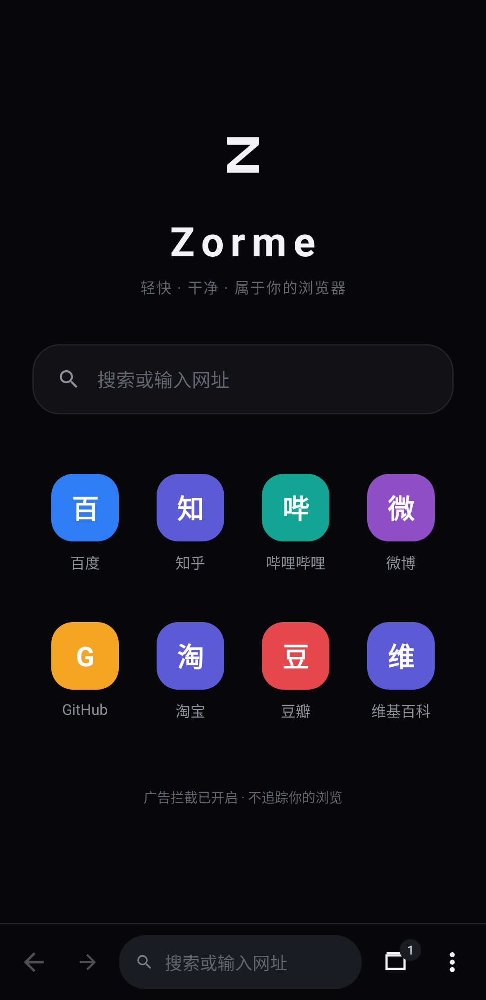
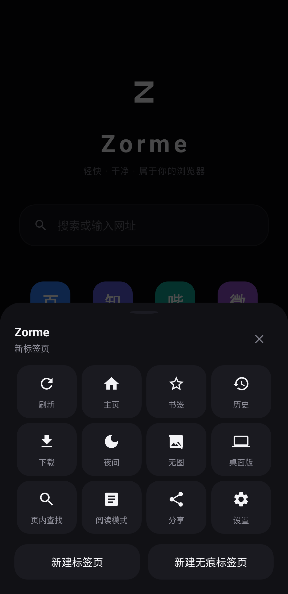
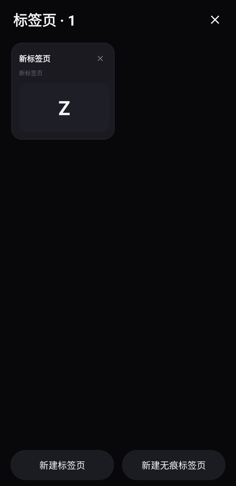
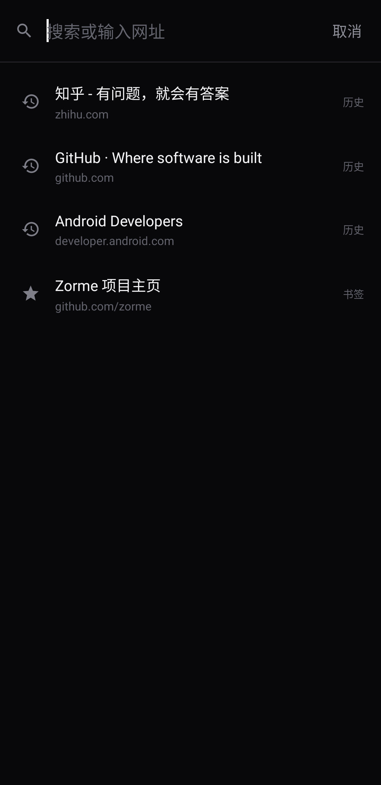
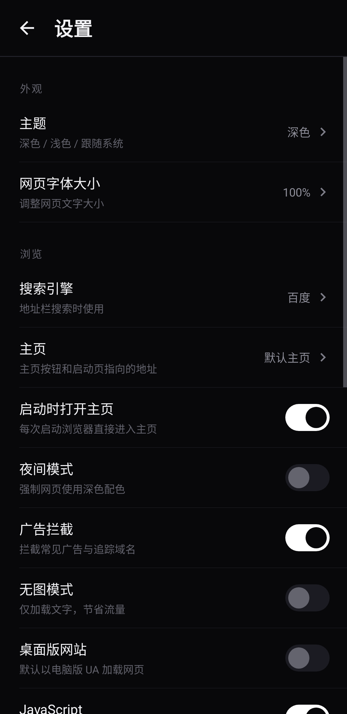
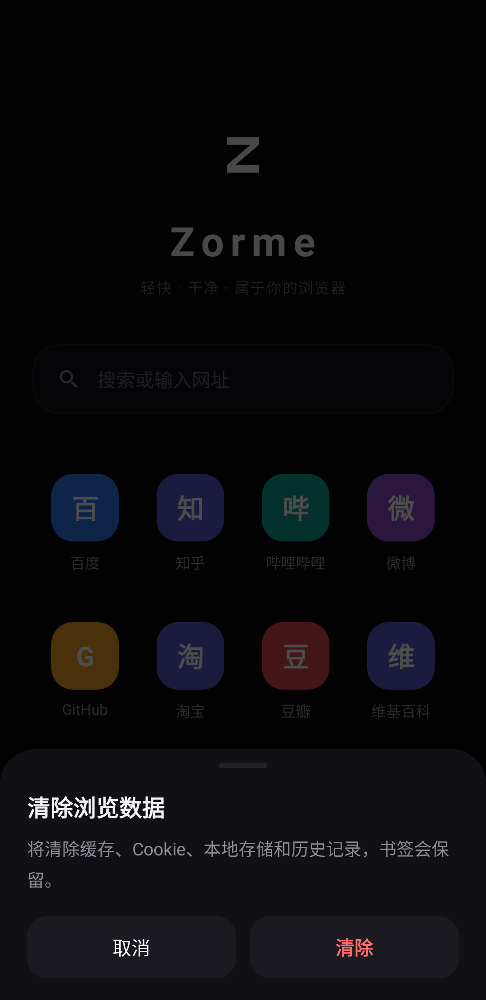

<p align="center">
  
</p>

<h1 align="center">Zorme 浏览器</h1>

<p align="center">
  基于 Android 系统 WebView 构建的轻量浏览器<br/>
  <b>轻量、干净、不打扰</b>
</p>

<p align="center">
  <a href="https://github.com/lmxdg/ZormeBrowser/releases/latest"></a>
  
  
  
</p>

---

## 下载

前往 [Releases](https://github.com/lmxdg/ZormeBrowser/releases) 页面下载最新的已签名 APK，下载后直接安装即可（安装时允许"未知来源应用"）。

也可以在应用内检查更新：**菜单 → 设置 → 关于 → 检查更新**。Zorme 会拉取 GitHub Releases 的最新版本号与本地版本对比，发现新版本时通过内置弹窗提示，可直接下载安装包或跳转发布页。

## 功能特性

**浏览核心**
- 基于 Android 系统 WebView，多标签浏览，卡片式标签页管理（带预览色块）
- Via 风格底部地址栏：返回 / 前进 / 地址胶囊 / 标签数徽标 / 菜单，单手操作
- 智能地址栏：自动识别网址与搜索词，本地历史、书签实时建议
- 主页起始页：Zorme 标识、搜索框、常用网站快捷方式
- 边缘滑动前进 / 后退手势

**浏览器标识（UA）**
- 支持 桌面版 Chrome / iPhone / iPad / 自定义字符串 多种 UA 模式
- 选自定义模式可填入任意 User-Agent，立即应用到所有标签页
- 菜单里的"桌面版网站"开关与 UA 模式自动保持同步

**效率与隐私**
- 广告与追踪域名拦截（内置规则表，可在设置中开关）
- 夜间模式（优先系统算法暗色，旧内核自动回退反色注入）
- 无图模式、无痕标签页（不记历史、不落缓存）
- 阅读模式、页内查找、页内翻译入口
- 记录浏览历史开关、清除缓存 / Cookie / 历史 / 全部数据

**细节体验**
- 搜索引擎可切换：百度、必应、Google、搜狗、360、神马、DuckDuckGo
- 自定义主页地址、网页字体大小（80%–150%）
- 长按链接 / 图片弹出内置操作菜单（新标签打开、复制、下载、保存图片）
- 外部 scheme 智能处理：`intent://` 自动解析目标应用并支持 `browser_fallback_url` 回退，未安装应用时静默交给网页自身的跳转逻辑，不再弹"无法打开"打断浏览
- 全屏视频播放、文件上传 / 下载（系统 DownloadManager）、多窗口

**内置弹窗体系**
- 全部对话框（确认 / 输入 / 单选 / 操作列表 / 浮层提示）以及网页的 `alert` / `confirm` / `prompt` 均为应用内自绘卡片，底部升起 + 遮罩动画，不调用任何系统原生弹窗

**检测更新**
- 内置更新检测，对比 GitHub Releases 最新 tag 与本地版本号（语义化比较）
- 发现新版本时通过内置弹窗展示更新说明，支持直接下载 APK 或打开发布页

## 界面预览

| 主页 | 菜单 | 标签页 |
|:---:|:---:|:---:|
|  |  |  |
| **地址栏建议** | **设置** | **确认弹窗** |
|  |  |  |

## 构建

环境要求：JDK 17、Android SDK（platforms;android-34、build-tools;34.0.0）、Gradle 8.7（或直接使用 `./gradlew`）。

```bash
git clone https://github.com/lmxdg/ZormeBrowser.git
cd ZormeBrowser
# 在 local.properties 中配置 sdk.dir（Android Studio 打开会自动生成）
./gradlew assembleRelease
```

产物位于 `app/build/outputs/apk/release/app-release.apk`。

仓库内的 `zorme-release.jks` 是测试签名（密码 `zorme2024`），**仅供开发调试使用**，正式发布请替换为你自己的密钥。

## 项目结构

```
app/src/main/java/com/zorme/browser/
├── MainActivity.java      # 主界面：标签、地址栏、菜单、手势、WebViewClient
├── ZWebView.java          # WebView 子类（长按检测、滚动监听）
├── BrowserTab.java        # 单个标签页状态
├── TabManager.java        # 标签管理
├── ZDialog.java           # 内置自绘弹窗体系
├── ZSwitch.java           # 自绘开关控件
├── WebSettingsHelper.java # WebView 统一配置（UA、夜间模式等）
├── UpdateChecker.java     # GitHub Releases 更新检测
├── AdBlocker.java         # 广告域名拦截
├── SearchEngine.java      # 搜索引擎定义
├── DbHelper.java          # 书签 / 历史 / 下载记录
├── Session.java           # 标签会话持久化
├── Prefs.java             # 全局偏好设置
└── ...
```

## 测试

```bash
./gradlew testDebugUnitTest
```

基于 Robolectric 的 25+ 个单元测试，覆盖：Activity 启动、菜单 / 标签 / 地址栏交互、内置弹窗行为（无系统弹窗断言）、自定义 UA 应用、intent 链接回退地址提取、版本号比较等。

## 说明

- 需要设备已安装 [Android System WebView](https://play.google.com/store/apps/details?id=com.google.android.webview)（绝大多数系统自带并保持更新）
- 检测更新与下载 APK 需要网络可访问 `github.com`

## License

[MIT](LICENSE)
